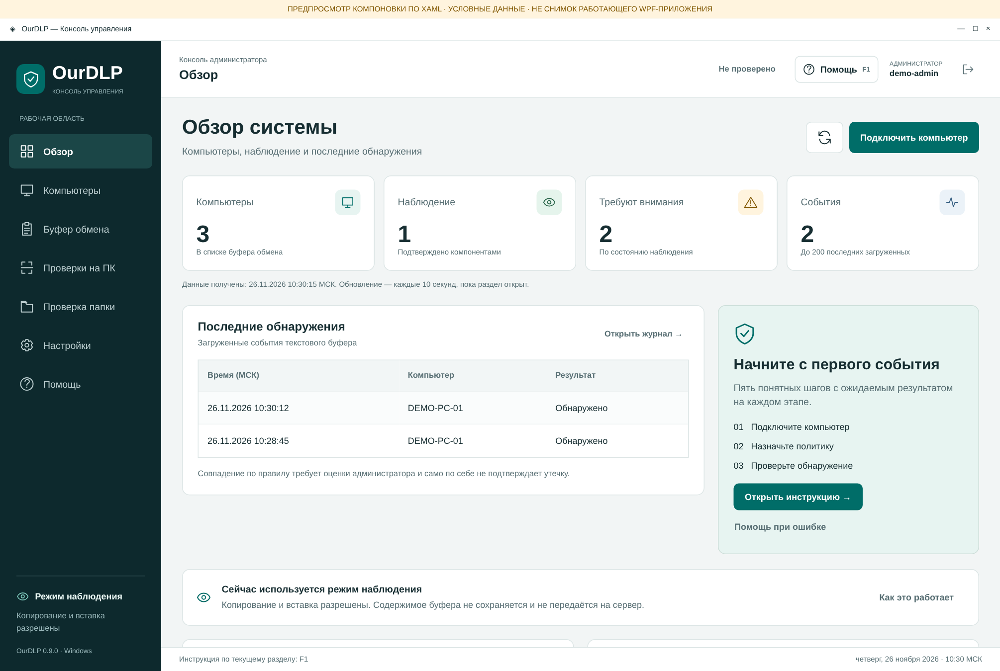

# OurDLP 0.9.0 — новый дизайн, 26.11.2026

- [Готовая программа Windows x64](https://github.com/NikoNovGTO/opendlp/raw/refs/heads/ourdlp-delivery-20261123/deliveries/ourdlp-design-20261126/OurDLP-design-win-x64.zip)
- [Небольшое обновление комплекта 0.8.2/0.8.3](https://github.com/NikoNovGTO/opendlp/raw/refs/heads/ourdlp-delivery-20261123/deliveries/ourdlp-design-20261126/OurDLP-design-update.zip)
- [Исходники Visual Studio](https://github.com/NikoNovGTO/opendlp/raw/refs/heads/ourdlp-delivery-20261123/deliveries/ourdlp-design-20261126/OurDLP-design-source.zip)

## Что изменилось

Тёмная боковая панель, бирюзовый акцент, собственные локальные векторные иконки и ICO, компактная верхняя строка, новое окно входа. Единые кнопки, поля, списки, таблицы и вкладки; текстовые и цветовые статусы; отдельная карточка подключения ПК и выделенные действия регистрации. Сохранены русская помощь, F1 и прежние подтверждения действий. Обновлено и оформление окна запуска.

На главной странице появились настоящие показатели из API буфера обмена, последние загруженные обнаружения и быстрые переходы. Пока данные не получены, показывается «—». Ошибка обновления и последние сведения явно подписаны; фильтр журнала не скрывает записи сводки. Показатели относятся к загруженному списку буфера, а не к полному охвату всех сеансов или количеству всех утечек.

Код разделён на словари оформления и небольшие компоненты панелей/карточек. Серверный API, движок, агентский протокол и формат базы не менялись. Сервер, Agent и Session в архиве побайтно прежние из исправленного 0.8.2. Версия консоли/комплекта — 0.9.0. Подробности — DESIGN.md в архивах; текст изменений — changes.diff.

## Предпросмотр

[Обзор](preview/overview.png) · [Компьютеры](preview/devices.png) · [Буфер обмена](preview/clipboard.png) · [Вход](preview/login.png)

Изображения — отдельный предпросмотр компоновки по новым XAML и палитре с **условными данными**, а не снимки работающего WPF-приложения. Это явно написано в каждом изображении. Они помогают оценить дизайн, но не служат нативным тестом.

## Как обновить

1. В **прежнем окне запуска** остановите свой сервер кнопкой, затем закройте консоль и окно запуска. Установленную службу агента останавливать для смены интерфейса не требуется.
2. Распакуйте полный комплект в новую папку либо маленькое обновление прямо рядом с ЗАПУСТИТЬ.cmd в прежнем комплекте 0.8.2/0.8.3 с заменой файлов. В маленьком ZIP внешней папки нет.
3. Откройте ЗАПУСТИТЬ.cmd обычным пользователем Windows, запустите сервер и консоль. При уже готовой базе первичная подготовка повторно не нужна.

Настройки, база и регистрация сохраняются. PostgreSQL 17 должен быть установлен и запущен; .NET включён в полный комплект, Visual Studio для готовой программы не нужна. Исправление прежней ошибки установки включено; успех повторной установки на ПК пользователя ещё не подтверждён. Маленькое обновление проверено относительно исходного/исправленного комплекта 0.8.2 и комплекта 0.8.3.

## Проверка

Release и публикация Windows x64 без ошибок/предупреждений. **202 теста** логики/файлов/настоящего PostgreSQL, 14 переносимых проверок запуска, 12 проверок восстановления установки; синтаксис 24 PowerShell-файлов. Проверены XAML и именованные ресурсы, палитра восьми основных пар текста/фона (расчётный контраст ≥5.41:1), состав/хеши/self-contained PE/ZIP и отсутствие реальных тестовых секретов. Контрольные суммы — SHA256SUMS.txt.

**Реальные окна WPF/WinForms, клавиатура/выпадающие списки/F1, масштабирование в Windows, SCM/UAC/DPAPI/ACL и настоящий буфер здесь не исполнялись.** Нативная приёмка описана в DESIGN.md. Оформление не добавляет блокировку: копирование и вставка разрешены, USB/печать/сетевые передачи пока не блокируются. master и прежний OpenDLP сохранены.
