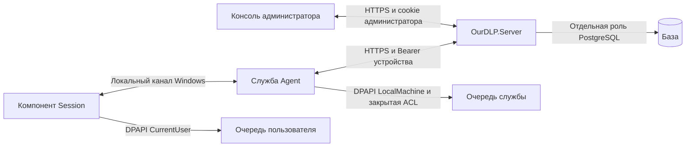

# Целевая техническая проверка OurDLP 0.10.1

Дата: 26.11.2026. Основа: исходники и опубликованные сборки 0.10.0. Область: локальный канал Agent/Session, подтверждения доставки, восстановление связи, браузерные запросы к API и приватность ответов. Это первый проход по указанным направлениям, без заявления о полном соответствии ASVS или независимом аудите.

## Границы доверия

Данные запроса и подтверждения проверяются на каждой границе. Клиентский Origin служит дополнительной защитой браузерного обмена; доступ к административным операциям и операциям агента определяется отдельными схемами аутентификации.

## Подтверждённые дефекты и исправления

### 1. Противоречивые подтверждения меняли очередь

На исходных сборках Session 0.10.0 воспроизведён ответ с одним ID одновременно в Accepted и Rejected. Событие удалялось из Pending и учитывалось как отклонённое. Это ошибка проверки протокола и учёта доставки; для подмены ответа требуется возможность отвечать от доверенного сервера/канала, обход TLS не продемонстрирован.

Теперь единый ClipboardAcknowledgements проверяет размер, уникальность, принадлежность отправленной партии, ненулевые ID и состав отклонений. Противоречивые ответы отвергаются целиком до записи. Подтверждения другой регистрации также не удаляют события прежней. Нормальные частичные подтверждения разрешены.

### 2. Ошибочный ответ завершал цикл Session

В прежнем цикле обработка IOException не включала InvalidDataException: эти типы имеют разную иерархию. Поэтому ошибки размера/состава сообщений могли завершить задачу связи; окно обнаруживало остановку и требовало перезапуска компонента. На прежних сборках подтверждена иерархия исключений и проверен исходный фильтр обработки.

SessionSyncLoop обрабатывает ожидаемые ошибки формата, JSON, связи и защищённого хранилища с повтором через прежние 5 секунд. Транспорт возвращает отсутствие ответа при плохом кадре. Последняя корректная политика и очередь сохраняются. Состояние связи подтверждается после проверки и применения ответа, а не сразу после его получения.

В службе ClipboardAgentExchangeCycle повторяет только обмен с некорректным ответом протокола. Исключения хранилища остаются вне этого фильтра; отзыв доступа сохраняет прежнюю остановку. Тесты отдельно проверяют IOException и InvalidDataException из записи, чтобы не скрывать сбой диска как обычную сетевую ошибку.

### 3. Порядок проверки Windows-канала

Документация ImpersonateNamedPipeClient связывает контекст олицетворения с последним прочитанным сообщением. Ранее WindowsClipboardPeer.Read выполнялся перед первым чтением. Теперь сначала читается и проверяется четырёхбайтовый заголовок, затем проверяются клиент/сеанс/путь процесса, и только после этого выделяется буфер, читается и разбирается содержимое. Координатор вызывается после успешной проверки личности.

Сохранены ограничение кадра 256 КиБ, общий срок подключения/обмена 3 секунды, запрет удалённых клиентов, первый экземпляр канала, права клиента без FILE_CREATE_PIPE_INSTANCE, проверка владельца канала со стороны Session. Переносимый тест подтверждает последовательность вызовов и отсутствие чтения тела при отказе в доступе. Нативная работоспособность impersonation/ACL требует Windows; успешное испытание реального Win32 здесь не заявляется.

## Дополнительное усиление API

Для изменяющих методов /api проверяются браузерные заголовки:

- Sec-Fetch-Site при наличии должен иметь единственное значение same-origin. Same-site также требует отдельного доверия и здесь отклоняется.
- Origin при наличии должен иметь единственное корректное значение со схемой, именем и портом текущего сервера; null, другой порт, userinfo, путь, query и fragment отклоняются.
- Подставленные X-Forwarded-Host/Proto самостоятельно не меняют доверенный адрес. Настройки обратного прокси в этом выпуске не добавлены.
- Нативная консоль и агент без браузерных заголовков проходят прежнюю обязательную аутентификацию. CORS не открывается.

SameSite=Strict сохранён. Новый барьер предотвращает обработку запросов другого браузерного источника и не заменяет авторизацию. На настоящей PostgreSQL проверено, что такой запрос с действующим административным cookie не отзывает агент и не завершает сеанс администратора; последующий штатный запрос работает.

Все ответы /api помечаются Cache-Control: no-store, включая ошибки и сведения о политиках. Клиентам и промежуточным кешам явно запрещено сохранять эти ответы.

## Проверенные существующие меры

Проверены соответствующие участки кода и регрессионные тесты: разные схемы администратора/агента, обязательный HTTPS чувствительных API, стандартная проверка TLS клиентов, отзыв cookie через security stamp, лимиты входа/регистрации и размера запросов, параметризованные запросы EF, роль БД без полномочий суперпользователя, ограниченные очереди и анализ, отсутствие содержимого буфера в событиях, защита CSV от формул.

DPAPI LocalMachine сочетается с закрытой ACL каталога службы. DPAPI CurrentUser относится к пользовательскому профилю. Пользовательский компонент не является защитой от произвольного кода в том же пользовательском контексте, а локальный администратор находится вне модели защиты от подмены агента. Защита от остановки/удаления и подписанный механизм обновления не реализованы.

Автоматическая проверка NuGet-зависимостей семи проектов, включая транзитивные, завершилась без ошибок и не сообщила известных уязвимостей в доступном источнике advisories. Это результат конкретного прогона; он не покрывает уязвимости ОС и не доказывает отсутствие неизвестных дефектов.

## Обязательная проверка на Windows

На Windows 10/11 x64 после обновления Agent/Session до 0.10.1:

1. Под обычным пользователем запустить Session; убедиться в подтверждении назначенной политики, скопировать новый маркер и проверить реальное событие.
2. Повторить под вторым пользователем/сеансом: убедиться в верных SID/имени/сеансе и независимом подтверждении.
3. Проверить отказ произвольной программе-клиенту, чужому владельцу канала и удалённому подключению. Убедиться в разрешённых правах ACL и отсутствии права создания экземпляра у обычных клиентов.
4. Остановить сервер, получить офлайн-событие, перезапустить Session/службу в допустимом порядке и проверить последующую единственную доставку.
5. Проверить отказы чтения/записи и повреждённое состояние на изолированной тестовой установке: существующие данные должны сохраняться, ошибка должна быть видна.

Linux-переносимые тесты не выполняют Win32, DPAPI, SCM, UAC, реальную ACL или нативный захват буфера. Их результаты не подменяют эти испытания.

## Источники

- [Microsoft: ImpersonateNamedPipeClient](https://learn.microsoft.com/en-us/windows/win32/api/namedpipeapi/nf-namedpipeapi-impersonatenamedpipeclient)
- [Microsoft: Named Pipe Security and Access Rights](https://learn.microsoft.com/en-us/windows/win32/ipc/named-pipe-security-and-access-rights)
- [OWASP: CSRF Prevention Cheat Sheet](https://cheatsheetseries.owasp.org/cheatsheets/Cross-Site_Request_Forgery_Prevention_Cheat_Sheet.html)
- [Microsoft: ASP.NET Core antiforgery](https://learn.microsoft.com/en-us/aspnet/core/security/anti-request-forgery?view=aspnetcore-10.0)

Рекомендации сопоставлены с .NET 10 и текущими нативными клиентами. Автоматическая защита более новых версий ASP.NET Core не предполагается доступной в нашей версии. Отчёт фиксирует конкретные проверенные направления и оставшиеся нативные испытания.
